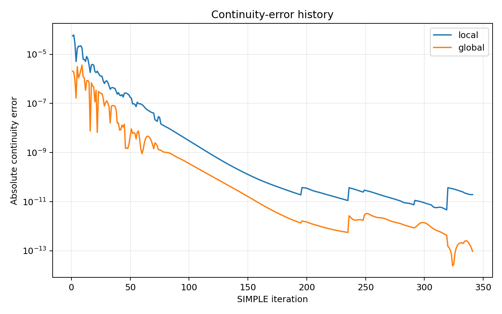
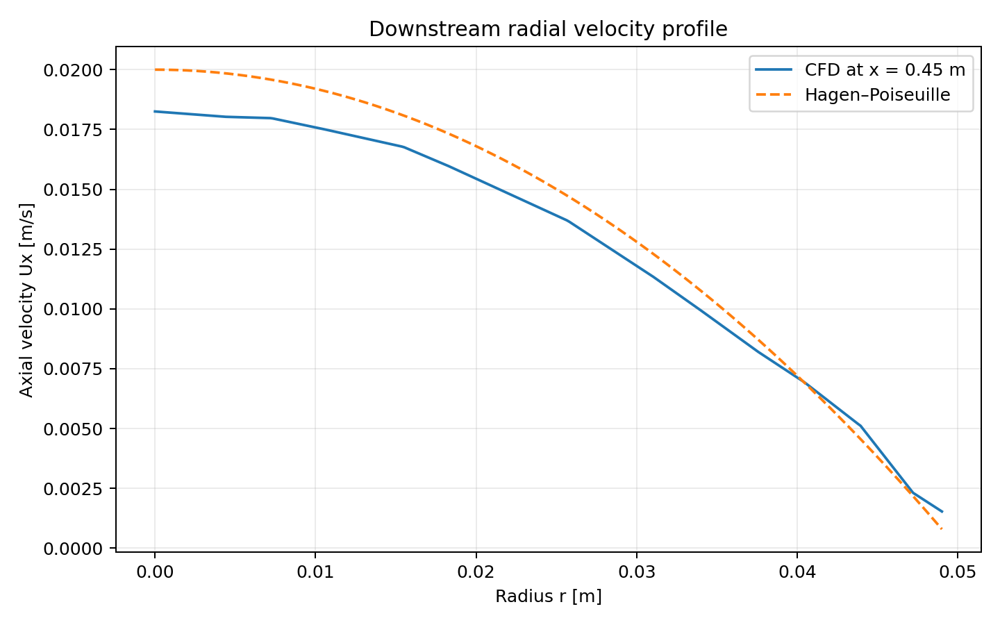
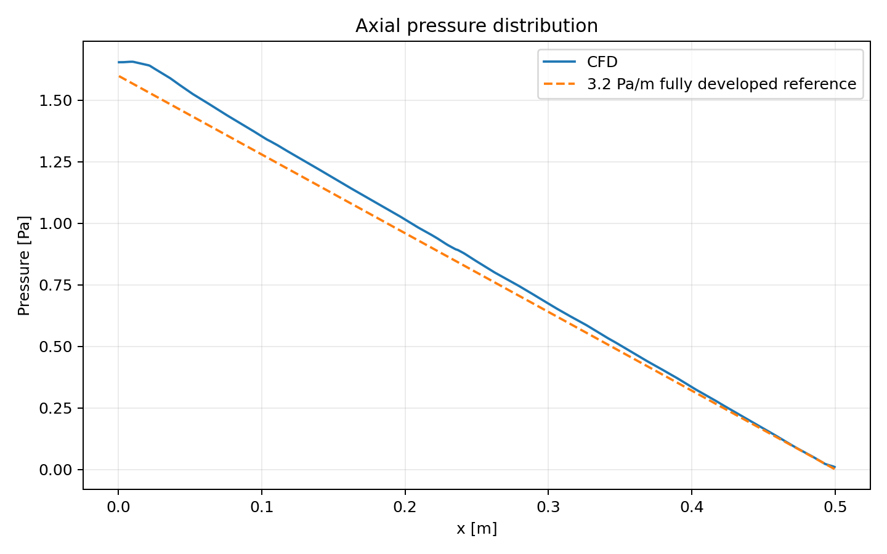
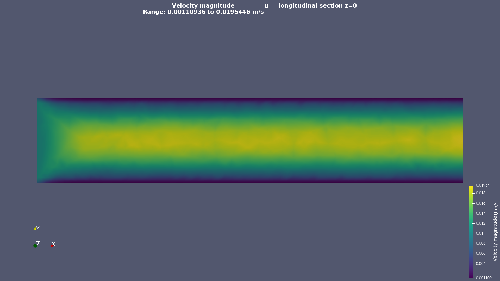
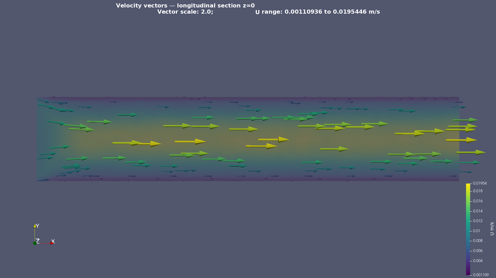
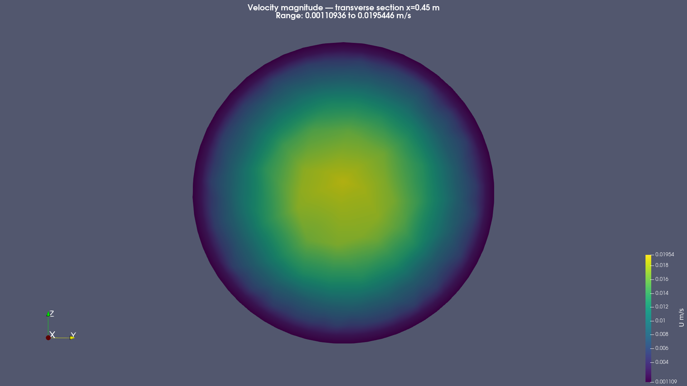

<div align="center">

# Steady Laminar Flow in a Circular Pipe  
## CFD Verification Benchmark

**A verification-focused CFD case study for low-Reynolds-number internal flow, combining analytical fluid mechanics, OpenFOAM 12, mesh-quality assessment, convergence tracking, conservation checks, and quantitative validation against Hagen–Poiseuille theory.**

<br>

**OpenFOAM 12** · **Laminar Internal Flow** · **Hagen–Poiseuille Validation** · **Mesh Verification** · **Convergence Analysis** · **Engineering Reproducibility**

</div>

---

## Why this project matters

A CFD result is only useful if it can survive technical scrutiny.

This benchmark was built around a simple geometry so that every major numerical result could be checked against an independent analytical reference. The objective was not merely to obtain a velocity contour, but to demonstrate a complete verification workflow:

> **physics definition → mesh quality → numerical convergence → conservation → analytical validation → reproducible evidence**

The case models steady, incompressible, laminar flow through a straight circular pipe with a uniform inlet profile. Because the inlet is not initially fully developed, the solution contains both an entrance-region effect and a downstream region that can be compared directly with Hagen–Poiseuille theory.

---

## Engineering snapshot

| Metric | Result |
|---|---:|
| Reynolds number | **9** |
| Final mesh cells | **33,917** |
| Tetrahedra | **22,825** |
| Prisms | **11,092** |
| Max non-orthogonality | **58.557°** |
| Max skewness | **0.5419** |
| Minimum determinant | **0.05036** |
| Failed mesh checks | **0** |
| SIMPLE iterations | **341** |
| Mass-conservation error | **5.10 × 10⁻¹⁰ %** |
| Maximum downstream velocity | **0.0199034 m/s** |
| Analytical maximum velocity | **0.0200000 m/s** |
| Developed CFD pressure gradient | **3.3977 Pa/m** |
| Hagen–Poiseuille pressure gradient | **3.2000 Pa/m** |
| Total CFD pressure drop | **1.89817 Pa** |

---

## Problem definition

A Newtonian fluid flows through a horizontal circular pipe aligned with the global **x-axis**.

| Quantity | Value |
|---|---:|
| Pipe diameter, `D` | 0.100 m |
| Pipe radius, `R` | 0.050 m |
| Pipe length, `L` | 0.500 m |
| Density, `ρ` | 900 kg/m³ |
| Dynamic viscosity, `μ` | 0.100 Pa·s |
| Kinematic viscosity, `ν` | 1.111111 × 10⁻⁴ m²/s |
| Mean inlet velocity, `Uₘ` | 0.010 m/s |
| Reynolds number | 9 |
| Inlet | `U = (0.01, 0, 0)` m/s |
| Outlet | reference pressure `p = 0` |
| Wall | no-slip |
| Gravity | neglected |
| Thermal effects | neglected |

The inlet velocity profile is uniform, so the flow develops spatially before approaching the fully developed parabolic profile.

---

## Analytical reference

The benchmark is deliberately chosen so that the CFD solution can be compared with classical laminar pipe-flow theory.

### Kinematic viscosity

\[
\nu = \frac{\mu}{\rho}
\]

\[
\nu = \frac{0.100}{900}
= 1.111111\times10^{-4}\ \mathrm{m^2/s}
\]

### Cross-sectional area

\[
A = \frac{\pi D^2}{4}
\]

\[
A = 7.853981634\times10^{-3}\ \mathrm{m^2}
\]

### Volumetric flow rate

\[
Q = U_m A
\]

\[
Q = 7.853981634\times10^{-5}\ \mathrm{m^3/s}
\]

### Reynolds number

\[
Re = \frac{\rho U_m D}{\mu}
\]

\[
Re = 9
\]

The flow is therefore strongly laminar.

### Entrance length estimate

\[
\frac{L_e}{D} \approx 0.05Re
\]

\[
L_e \approx 0.045\ \mathrm{m}
\]

This is approximately **9% of the total pipe length**.

### Fully developed velocity profile

\[
u_x(r)=2U_m\left[1-\left(\frac{r}{R}\right)^2\right]
\]

The theoretical centerline velocity is therefore

\[
U_{\max}=2U_m=0.020\ \mathrm{m/s}
\]

### Hagen–Poiseuille pressure gradient

\[
\left|\frac{dp}{dx}\right|
=
\frac{32\mu U_m}{D^2}
=
3.2\ \mathrm{Pa/m}
\]

For a fully developed profile over the complete 0.5 m length,

\[
\Delta p_{HP}=1.6\ \mathrm{Pa}
\]

Because the CFD case begins with a uniform inlet profile, the total inlet-to-outlet pressure drop is expected to exceed the fully developed Hagen–Poiseuille value.

---

## Numerical model

The case uses **OpenFOAM Foundation 12** with a steady, incompressible, laminar formulation.

### Solver configuration

- Solver module: `incompressibleFluid`
- Transport model: laminar, constant viscosity
- Pressure–velocity coupling: consistent SIMPLE
- Non-orthogonal corrections: 2
- Pressure solver: GAMG
- Velocity solver: smoothSolver / symGaussSeidel
- Residual control:
  - `p = 1e-8`
  - `U = 1e-8`
- Pressure relaxation: `0.3`
- Velocity relaxation: `0.7`

OpenFOAM stores `p` as **kinematic pressure** in this case.

\[
p_{\mathrm{Pa}}=\rho\,p_{\mathrm{kinematic}}
\]

---

## Mesh verification

The final mesh combines tetrahedral cells with prism layers near the wall.

| Mesh metric | Final value |
|---|---:|
| Points | 11,233 |
| Cells | 33,917 |
| Tetrahedra | 22,825 |
| Prisms | 11,092 |
| Boundary patches | 3 |
| Max non-orthogonality | 58.557° |
| Mean non-orthogonality | 14.981° |
| Max skewness | 0.5419 |
| Max aspect ratio | 5.423 |
| Minimum determinant | 0.05036 |
| Cells with determinant < 0.001 | 0 |
| Total mesh volume | 3.912657850 × 10⁻³ m³ |
| Verification result | **Mesh OK** |

The exact cylindrical fluid volume is

\[
V_{\mathrm{CAD}}=3.926990817\times10^{-3}\ \mathrm{m^3}
\]

The discretized-volume difference is approximately **0.365%**, consistent with geometric facetization of the circular surface.

### Mesh evolution


### Mesh-quality evolution


---

## Solver convergence

The steady SIMPLE solution converged in **341 iterations**.


The continuity history confirms that the solution also satisfies global flow conservation to a very small numerical error.



---

## Quantitative results

| Quantity | CFD | Analytical reference | Interpretation |
|---|---:|---:|---|
| Volumetric flow rate | 7.84050081 × 10⁻⁵ m³/s | 7.85398163 × 10⁻⁵ m³/s | very close |
| Difference from exact-area flow | -0.1716% | — | consistent with faceted inlet area |
| Mass-conservation error | 5.10 × 10⁻¹⁰ % | 0% ideal | excellent conservation |
| Maximum downstream velocity | 0.0199034 m/s | 0.0200 m/s | -0.48% |
| `Umax / Um` | 1.9903 | 2.0000 | near theoretical parabolic limit |
| Developed pressure gradient | 3.3977 Pa/m | 3.2000 Pa/m | +6.18% |
| Total pressure drop | 1.89817 Pa | 1.6000 Pa | entrance-region contribution present |

---

## Validation against Hagen–Poiseuille theory

### Velocity profile

The downstream radial profile approaches the analytical parabola expected for fully developed laminar flow.



The centerline velocity reaches approximately

\[
U_{\max}=0.0199034\ \mathrm{m/s}
\]

which is close to the analytical value

\[
U_{\max,\mathrm{HP}}=0.0200\ \mathrm{m/s}
\]

### Pressure gradient

The developed CFD pressure gradient is approximately

\[
3.3977\ \mathrm{Pa/m}
\]

compared with the Hagen–Poiseuille reference

\[
3.2000\ \mathrm{Pa/m}
\]



The total inlet-to-outlet pressure drop is larger than the fully developed full-length reference because the inlet profile must develop from uniform to parabolic.

---

## Flow-field visualization

### Velocity magnitude


### Physical pressure


### Longitudinal velocity



### Longitudinal pressure


### Streamlines


### Velocity vectors



### Downstream cross-section



---

## Engineering capabilities demonstrated

This benchmark is intentionally compact, but it demonstrates several core engineering capabilities that transfer directly to more complex CFD work:

- translating a physical problem into a numerical model;
- defining physically consistent boundary conditions;
- distinguishing total pressure-drop effects from developed-flow behavior;
- evaluating mesh quality using topology and geometry metrics;
- iterating mesh design based on quantitative quality evidence;
- tracking nonlinear/segregated steady-solver convergence;
- checking global conservation independently of residuals;
- interpreting OpenFOAM kinematic pressure correctly;
- validating CFD against an independent analytical solution;
- separating visualization from quantitative verification;
- packaging the case so results can be independently inspected and reproduced.

> **The objective is not to make CFD look convincing.  
> The objective is to make the result technically defensible.**

---

## Repository structure

```text
laminar-pipe-flow-cfd/
├── README.md
├── .gitignore
├── docs/
│   ├── problem_definition.md
│   ├── analytical_reference.md
│   ├── numerical_setup.md
│   ├── mesh_quality.md
│   ├── validation.md
│   ├── openfoam_case.md
│   └── results_catalog.md
├── openfoam_case/
│   ├── 0/
│   ├── 250/
│   ├── 341/
│   ├── constant/
│   ├── system/
│   ├── postProcessing/
│   └── results_basic.csv
├── data/
│   ├── benchmark_summary.csv
│   ├── convergence_history.csv
│   ├── mesh_iteration_history.csv
│   ├── boundary_patches.csv
│   ├── flow_balance.csv
│   ├── axial_pressure.csv
│   ├── axial_velocity.csv
│   └── radial_velocity_x045.csv
├── evidence/
│   ├── checkMesh_final.txt
│   └── solver_summary.txt
├── figures/
└── scripts/
    └── make_validation_plots.py
```

---

## Reproduce the CFD case

Use a copy of `openfoam_case/` if you want to preserve the included converged solution.

```bash
cd openfoam_case
checkMesh -allTopology -allGeometry
foamRun
```

The existing `250/` and `341/` directories are retained as technical evidence.

For a clean rerun from the prescribed initial condition, remove those two result directories **in a working copy** before launching the solver.

---

## Regenerate the validation plots

The repository includes a lightweight Python script that regenerates the principal engineering plots directly from the CSV data.

```bash
python scripts/make_validation_plots.py
```

Required Python package:

```bash
pip install matplotlib
```

The script does **not** rerun the CFD simulation. It only reproduces plots from the stored numerical data.

---

## Detailed technical documentation

- [Problem definition](docs/problem_definition.md)
- [Analytical reference](docs/analytical_reference.md)
- [Numerical setup](docs/numerical_setup.md)
- [Mesh quality and mesh evolution](docs/mesh_quality.md)
- [Validation and interpretation](docs/validation.md)
- [OpenFOAM case structure](docs/openfoam_case.md)
- [Data and figure catalog](docs/results_catalog.md)

---

## Verification philosophy

This repository follows a simple rule:

> **A successful solver exit is not, by itself, a successful engineering analysis.**

Confidence comes from combining several independent checks:

1. geometry and scale are correct;
2. the mesh passes quality checks;
3. the numerical solution converges;
4. mass is conserved;
5. the solution follows the expected physical trends;
6. key quantities agree with independent analytical references.

That hierarchy is the real purpose of this benchmark.

---

<div align="center">

### CFD should not only produce images. It should produce evidence.

**Steady Laminar Pipe Flow · OpenFOAM 12 · Analytical Verification · Reproducible Engineering**

</div>
