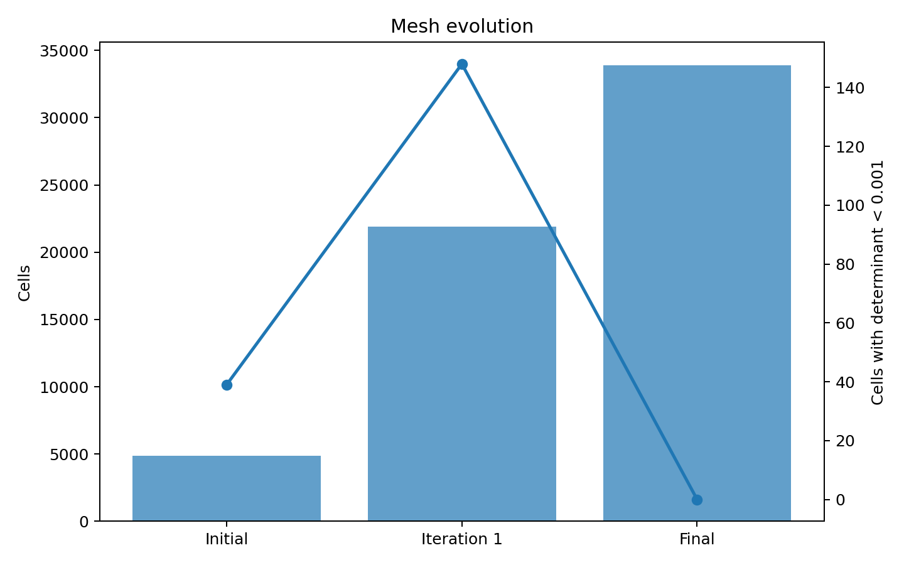
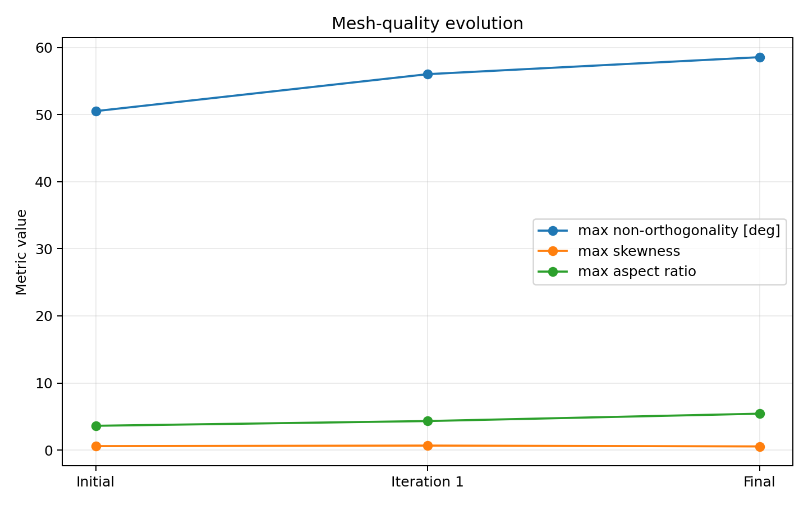
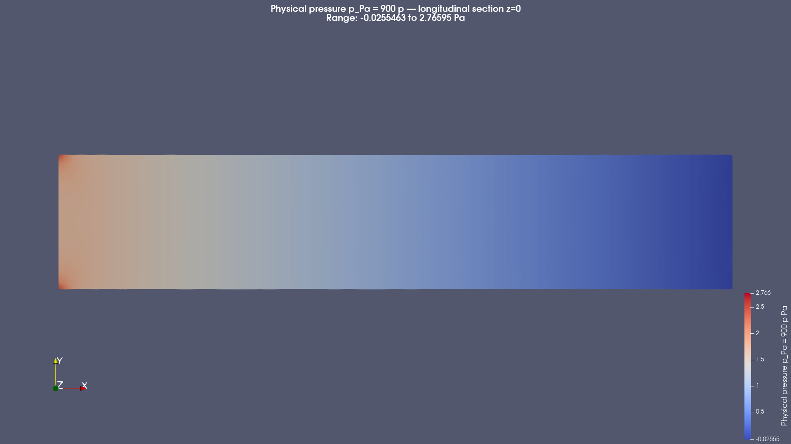
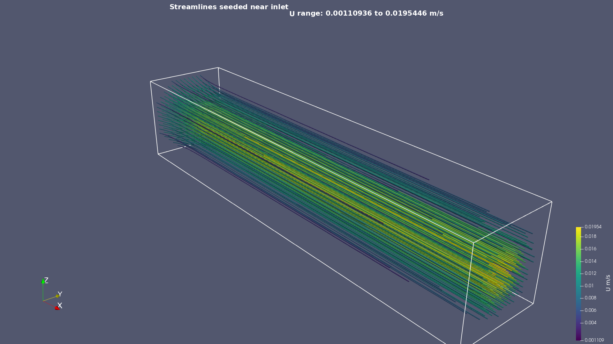

<!--
GitHub-compatible README.
Uses only Markdown + safe HTML supported by GitHub.
No external CSS or JavaScript is required.
-->

<div align="center">

# STEADY LAMINAR FLOW IN A CIRCULAR PIPE

### CFD Verification Benchmark · OpenFOAM 12 · Analytical Validation

<h3>Reinaldo J. Betancourt C.</h3>

<p>
<strong>Mechanical Engineering · Simulation Engineering · Digital Engineering</strong>
</p>

<p>
A verification-driven CFD case study for low-Reynolds-number internal flow, engineered to demonstrate not only a converged solution, but a technically defensible one.
</p>

<p>
  
  
  
  
  
</p>

<p>
<strong>Physics → Mesh Quality → Convergence → Conservation → Analytical Validation → Reproducible Evidence</strong>
</p>

</div>

---

<div align="center">

## ENGINEERING AT A GLANCE

<table>
<tr>
<td align="center"><b>Reynolds Number</b><br><br><font size="5"><b>9</b></font></td>
<td align="center"><b>Final Mesh</b><br><br><font size="5"><b>33,917</b></font><br>cells</td>
<td align="center"><b>SIMPLE Iterations</b><br><br><font size="5"><b>341</b></font></td>
<td align="center"><b>Mass Error</b><br><br><font size="5"><b>5.10×10⁻¹⁰%</b></font></td>
</tr>
<tr>
<td align="center"><b>CFD U<sub>max</sub></b><br><br><b>0.0199034 m/s</b></td>
<td align="center"><b>Analytical U<sub>max</sub></b><br><br><b>0.0200000 m/s</b></td>
<td align="center"><b>CFD dp/dx</b><br><br><b>3.3977 Pa/m</b></td>
<td align="center"><b>Analytical dp/dx</b><br><br><b>3.2000 Pa/m</b></td>
</tr>
</table>

</div>

---

## WHY THIS PROJECT MATTERS

A CFD contour can look convincing and still be wrong.

This benchmark was designed around a deliberately simple geometry so that every major numerical result could be challenged by an independent analytical reference. The purpose is not merely to obtain a converged OpenFOAM case. The purpose is to establish a chain of evidence showing that the solution is physically meaningful, numerically stable, conservative, and quantitatively consistent with classical laminar-flow theory.

> **The objective is not to make CFD look convincing. The objective is to make the result technically defensible.**

The case models a Newtonian fluid entering a straight circular pipe with a uniform axial velocity. The top-hat inlet profile develops toward the parabolic profile expected for fully developed Hagen–Poiseuille flow, creating a useful benchmark for both entrance-region physics and downstream verification.

---

## PROBLEM DEFINITION

<table>
<tr>
<td width="50%">

### Geometry

| Quantity | Value |
|---|---:|
| Diameter, `D` | **0.100 m** |
| Radius, `R` | **0.050 m** |
| Length, `L` | **0.500 m** |
| Pipe axis | **+x** |

</td>
<td width="50%">

### Fluid and boundary conditions

| Quantity | Value |
|---|---:|
| Density, `ρ` | **900 kg/m³** |
| Dynamic viscosity, `μ` | **0.100 Pa·s** |
| Mean inlet velocity | **0.010 m/s** |
| Inlet | `U=(0.01,0,0)` m/s |
| Outlet | `p=0` reference |
| Wall | no-slip |

</td>
</tr>
</table>

The model is steady, incompressible and isothermal. Gravity and thermal effects are neglected.

---

## ANALYTICAL BASELINE

The benchmark is anchored to the exact solution for fully developed laminar flow in a circular pipe.

### Core quantities

```text
ν  = μ / ρ
   = 1.111111 × 10⁻⁴ m²/s

A  = πD² / 4
   = 7.853981634 × 10⁻³ m²

Q  = Um A
   = 7.853981634 × 10⁻⁵ m³/s

Re = ρ Um D / μ
   = 9
```

A standard laminar entrance-length estimate gives:

```text
Le / D ≈ 0.05 Re
Le ≈ 0.045 m
```

which corresponds to approximately **9% of the pipe length**.

### Fully developed profile

```text
ux(r) = 2 Um [1 - (r/R)²]
```

Therefore:

```text
Umax = 2 Um = 0.020 m/s
```

and the Hagen–Poiseuille pressure gradient is:

```text
|dp/dx| = 32 μ Um / D² = 3.2 Pa/m
```

For a fully developed profile across the full 0.5 m:

```text
ΔpHP = 1.6 Pa
```

Because the CFD model starts from a uniform inlet profile rather than a pre-developed parabola, the total inlet-to-outlet pressure drop is expected to include an additional entrance-region contribution.

---

## NUMERICAL MODEL

<table>
<tr>
<td width="50%">

### Solver architecture

- **OpenFOAM Foundation 12**
- `foamRun`
- `incompressibleFluid`
- steady incompressible formulation
- constant-viscosity laminar transport
- consistent SIMPLE
- 2 non-orthogonal corrections

</td>
<td width="50%">

### Linear solution controls

- Pressure: **GAMG**
- Velocity: **smoothSolver / symGaussSeidel**
- Residual control:
  - `p = 1e-8`
  - `U = 1e-8`
- Relaxation:
  - `p = 0.3`
  - `U = 0.7`

</td>
</tr>
</table>

For this case, OpenFOAM stores `p` as **kinematic pressure**, so the physical pressure is recovered through:

```text
pPa = ρ · pkinematic
```

---

## MESH: FROM DISCRETIZATION TO VERIFIED DOMAIN

<div align="center">

<table>
<tr>
<td align="center"><b>Points</b><br><br><b>11,233</b></td>
<td align="center"><b>Cells</b><br><br><b>33,917</b></td>
<td align="center"><b>Tetrahedra</b><br><br><b>22,825</b></td>
<td align="center"><b>Prisms</b><br><br><b>11,092</b></td>
</tr>
<tr>
<td align="center"><b>Max non-orthogonality</b><br><br><b>58.557°</b></td>
<td align="center"><b>Max skewness</b><br><br><b>0.5419</b></td>
<td align="center"><b>Min determinant</b><br><br><b>0.05036</b></td>
<td align="center"><b>Failed checks</b><br><br><b>0</b></td>
</tr>
</table>

</div>

The final discretized volume is:

```text
Vmesh = 3.912657850 × 10⁻³ m³
```

while the exact cylindrical fluid volume is:

```text
VCAD = 3.926990817 × 10⁻³ m³
```

The difference is approximately **0.365%**, consistent with geometric facetization of the circular surface.

<div align="center">

<table>
<tr>
<td align="center" width="50%">
<br>
<sub><b>Mesh evolution</b> — refinement history and removal of low-determinant cells.</sub>
</td>
<td align="center" width="50%">
<br>
<sub><b>Mesh-quality evolution</b> — non-orthogonality, skewness and aspect ratio.</sub>
</td>
</tr>
</table>

</div>

---

## CONVERGENCE AND CONSERVATION

The steady SIMPLE solution converged after **341 iterations**.

<div align="center">

<table>
<tr>
<td align="center" width="50%">
<br>
<sub><b>Residual history</b> — velocity components and pressure across the full solve.</sub>
</td>
<td align="center" width="50%">
<br>
<sub><b>Continuity history</b> — local and global continuity behavior.</sub>
</td>
</tr>
</table>

</div>

The final flow-rate imbalance is approximately:

```text
5.10 × 10⁻¹⁰ %
```

This provides an independent conservation check beyond algebraic residual convergence.

---

## CFD VS ANALYTICAL THEORY

<div align="center">

<table>
<tr>
<th>Quantity</th>
<th>CFD</th>
<th>Analytical</th>
<th>Assessment</th>
</tr>
<tr>
<td>Volumetric flow rate</td>
<td><b>7.84050081×10⁻⁵ m³/s</b></td>
<td>7.85398163×10⁻⁵ m³/s</td>
<td>Very close</td>
</tr>
<tr>
<td>Maximum downstream velocity</td>
<td><b>0.0199034 m/s</b></td>
<td>0.0200000 m/s</td>
<td><b>-0.48%</b></td>
</tr>
<tr>
<td>Umax / Um</td>
<td><b>1.9903</b></td>
<td>2.0000</td>
<td>Near parabolic limit</td>
</tr>
<tr>
<td>Developed pressure gradient</td>
<td><b>3.3977 Pa/m</b></td>
<td>3.2000 Pa/m</td>
<td><b>+6.18%</b></td>
</tr>
<tr>
<td>Total pressure drop</td>
<td><b>1.89817 Pa</b></td>
<td>1.6000 Pa</td>
<td>Entrance region included</td>
</tr>
</table>

</div>

### Radial velocity profile

The downstream profile approaches the parabolic shape predicted by Hagen–Poiseuille theory.

<div align="center">
<br>
<sub>CFD radial velocity profile compared with the analytical fully developed solution.</sub>
</div>

### Axial pressure behavior

<div align="center">
<br>
<sub>Axial pressure distribution compared with the fully developed analytical pressure-gradient reference.</sub>
</div>

The CFD pressure gradient downstream is close to theory, while the larger total pressure loss reflects the finite hydrodynamic development region.

---

## FLOW-FIELD VISUALIZATION

<div align="center">

<table>
<tr>
<td align="center" width="50%">
<br>
<sub><b>Velocity magnitude</b></sub>
</td>
<td align="center" width="50%">
<br>
<sub><b>Physical pressure [Pa]</b></sub>
</td>
</tr>
<tr>
<td align="center">
<br>
<sub><b>Longitudinal velocity field</b></sub>
</td>
<td align="center">
<br>
<sub><b>Longitudinal pressure field</b></sub>
</td>
</tr>
<tr>
<td align="center">
<br>
<sub><b>Streamlines</b></sub>
</td>
<td align="center">
<br>
<sub><b>Velocity vectors</b></sub>
</td>
</tr>
<tr>
<td colspan="2" align="center">
<br>
<sub><b>Downstream cross-section</b> — velocity structure near x = 0.45 m.</sub>
</td>
</tr>
</table>

</div>

---

## WHAT THIS BENCHMARK DEMONSTRATES

<table>
<tr>
<td width="33%" valign="top">

### Physics

- Low-Re internal flow
- Entrance-region development
- Fully developed laminar theory
- Pressure–velocity coupling
- Dimensional interpretation

</td>
<td width="33%" valign="top">

### Numerical verification

- Mesh-quality assessment
- Iterative mesh improvement
- Residual tracking
- Conservation checks
- Pressure-field interpretation

</td>
<td width="33%" valign="top">

### Engineering validation

- Independent analytical baseline
- Quantitative error assessment
- CFD/theory comparison
- Reproducible evidence
- Auditable case organization

</td>
</tr>
</table>

> **A successful solver exit is not, by itself, a successful engineering analysis.**

Confidence comes from a hierarchy of independent checks:

1. geometry and scale are correct;
2. the mesh passes topology and geometry checks;
3. the numerical solution converges;
4. global conservation is satisfied;
5. physical trends match the expected behavior;
6. key quantities agree with an independent analytical solution.

---


## REGENERATE VALIDATION PLOTS

The repository includes a lightweight Python script that regenerates the main engineering plots directly from the stored CSV files.

```bash
pip install matplotlib
python scripts/make_validation_plots.py
```

The script does **not** rerun CFD. It only regenerates plots from the numerical data already stored in the repository.

---

## TECHNICAL DOCUMENTATION

<table>
<tr>
<td>

- [Problem definition](docs/problem_definition.md)
- [Analytical reference](docs/analytical_reference.md)
- [Numerical setup](docs/numerical_setup.md)
- [Mesh quality and evolution](docs/mesh_quality.md)

</td>
<td>

- [Validation and interpretation](docs/validation.md)
- [OpenFOAM case structure](docs/openfoam_case.md)
- [Data and figure catalog](docs/results_catalog.md)

</td>
</tr>
</table>

---

<div align="center">

## ENGINEERING PRINCIPLE

### CFD should not only produce images. It should produce evidence.

**Steady Laminar Pipe Flow · OpenFOAM 12 · Analytical Verification · Reproducible Engineering**

<br>

<sub>
A compact benchmark built around traceability, physical interpretation, numerical verification, and quantitative validation.
</sub>

</div>
