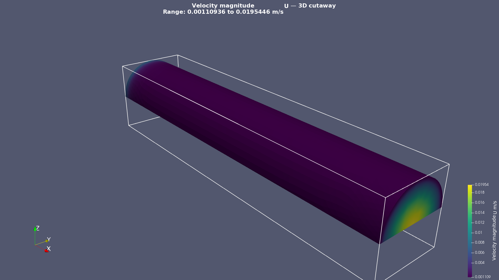
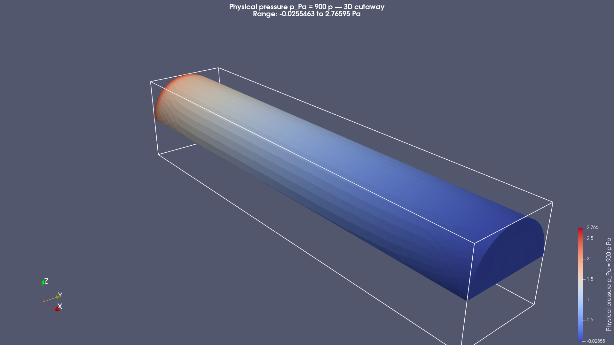
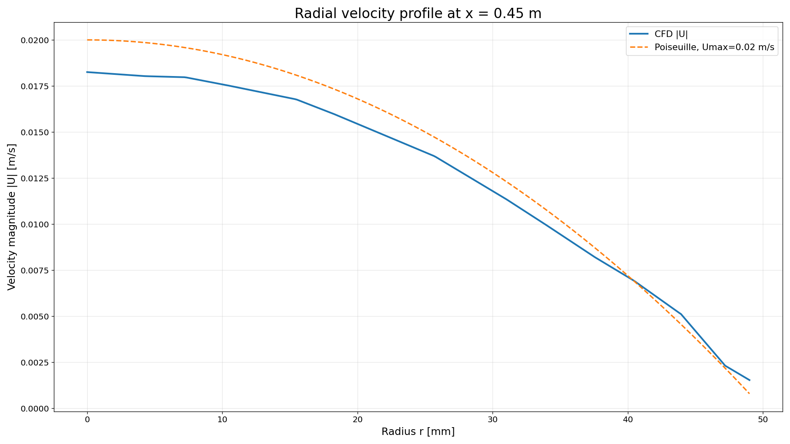
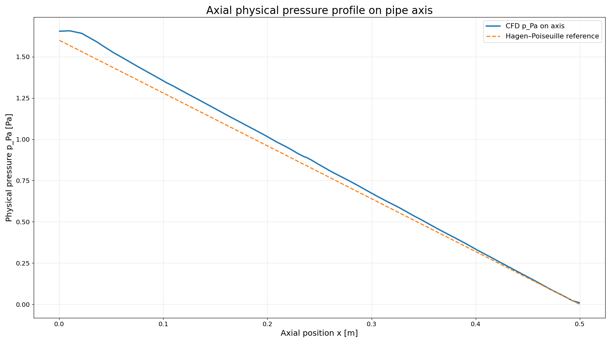
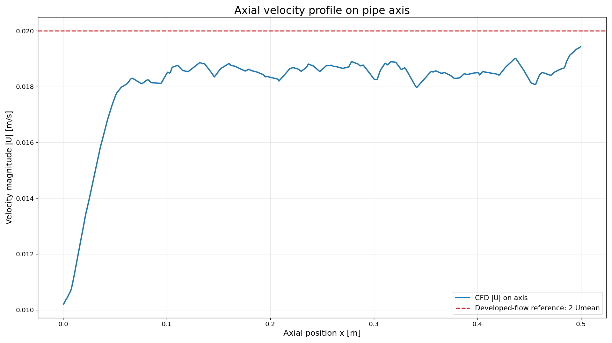
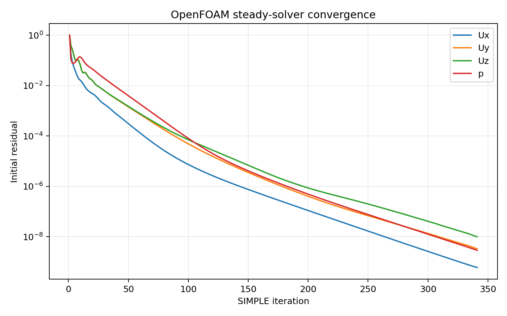

# Steady Laminar Flow in a Circular Pipe — CFD Verification Benchmark

This repository contains a complete technical benchmark for steady, incompressible, laminar flow through a straight circular pipe. It combines the physical problem definition, analytical Hagen–Poiseuille reference solution, an OpenFOAM 12 case, final mesh and solution fields, convergence data, post-processing data, and validation figures.

The repository is intentionally focused on the engineering problem itself: governing physics, numerical model, mesh quality, solver convergence, conservation, and comparison with analytical theory.

## Problem at a glance

A Newtonian fluid enters a horizontal circular pipe with a uniform axial velocity. The flow develops from the imposed top-hat inlet profile toward the parabolic profile expected for fully developed laminar pipe flow.

| Quantity | Value |
|---|---:|
| Pipe diameter, `D` | 0.100 m |
| Pipe radius, `R` | 0.050 m |
| Pipe length, `L` | 0.500 m |
| Density, `rho` | 900 kg/m³ |
| Dynamic viscosity, `mu` | 0.100 Pa·s |
| Kinematic viscosity, `nu` | 1.111111e-4 m²/s |
| Mean inlet velocity, `Um` | 0.010 m/s |
| Reynolds number | 9 |
| Inlet | `U = (0.01, 0, 0)` m/s |
| Outlet | reference pressure `p = 0` |
| Wall | no-slip |
| Gravity | neglected |
| Thermal effects | neglected |

The pipe axis is the global `x` axis and the flow direction is `+x`.

## Analytical reference

For the prescribed properties,

```text
nu = mu / rho = 1.111111e-4 m²/s
A  = pi D² / 4 = 7.853981634e-3 m²
Q  = Um A       = 7.853981634e-5 m³/s
Re = rho Um D / mu = 9
```

A common laminar entrance-length estimate gives

```text
Le / D ≈ 0.05 Re
Le ≈ 0.045 m ≈ 9 % of the pipe length
```

For fully developed laminar flow in a circular pipe,

```text
u_x(r) = 2 Um [1 - (r/R)²]
Umax   = 2 Um = 0.020 m/s
|dp/dx| = 32 mu Um / D² = 3.2 Pa/m
Delta p_HP = 1.6 Pa over L = 0.5 m
```

Because the inlet profile is uniform rather than already parabolic, the inlet-to-outlet pressure drop includes a developing-flow contribution. The downstream pressure gradient and radial velocity profile are therefore the strongest analytical validation quantities.

## Numerical model

The included case uses OpenFOAM Foundation 12 with a steady incompressible laminar formulation.

- Solver module: `incompressibleFluid`
- Transport model: laminar, constant viscosity
- Pressure–velocity coupling: consistent SIMPLE
- Non-orthogonal corrections: 2
- Pressure solver: GAMG
- Velocity solver: smoothSolver / symGaussSeidel
- Convergence controls: `p = 1e-8`, `U = 1e-8`
- Pressure relaxation: 0.3
- Velocity relaxation: 0.7

OpenFOAM stores `p` as kinematic pressure for this case. Physical pressure is therefore

```text
p_Pa = rho * p_kinematic
```

## Final mesh

| Metric | Final value |
|---|---:|
| Points | 11,233 |
| Cells | 33,917 |
| Tetrahedra | 22,825 |
| Prisms | 11,092 |
| Boundary patches | 3 |
| Max non-orthogonality | 58.557° |
| Mean non-orthogonality | 14.981° |
| Max skewness | 0.5419 |
| Max aspect ratio | 5.423 |
| Minimum determinant | 0.05036 |
| Cells with determinant < 0.001 | 0 |
| Total mesh volume | 3.912657850e-3 m³ |
| Mesh verification | `Mesh OK` |

The exact cylindrical fluid volume is `3.926990817e-3 m³`, so the final discretized volume differs by approximately `0.365 %`, consistent with surface facetization.

## Main results

| Quantity | CFD result | Analytical reference |
|---|---:|---:|
| Volumetric flow rate | 7.84050081e-5 m³/s | 7.85398163e-5 m³/s |
| Difference from exact-area flow rate | -0.1716 % | — |
| Mass conservation error | 5.10e-10 % | 0 % ideal |
| Maximum downstream velocity | 0.0199034 m/s | 0.0200 m/s |
| `Umax / Um` | 1.9903 | 2.0000 |
| Developed pressure gradient | 3.3977 Pa/m | 3.2000 Pa/m |
| Total pressure drop | 1.89817 Pa | 1.6000 Pa fully developed |
| SIMPLE iterations | 341 | — |

The downstream maximum velocity differs from the fully developed value by about `-0.48 %`. The developed pressure gradient is about `+6.18 %` above the Hagen–Poiseuille value. The larger total pressure drop (`+18.64 %` relative to the fully developed full-length value) is consistent with the finite entrance region.

## Validation figures

### Velocity magnitude



### Physical pressure



### Radial velocity profile at x = 0.45 m



### Axial pressure profile



### Axial velocity development



### Solver convergence



### Mesh evolution


## Repository structure

```text
laminar-pipe-flow-cfd/
├── README.md
├── .gitignore
├── docs/
│   ├── problem_definition.md
│   ├── analytical_reference.md
│   ├── numerical_setup.md
│   ├── mesh_quality.md
│   ├── validation.md
│   ├── openfoam_case.md
│   └── results_catalog.md
├── openfoam_case/
│   ├── 0/
│   ├── 250/
│   ├── 341/
│   ├── constant/
│   ├── system/
│   ├── postProcessing/
│   └── results_basic.csv
├── data/
│   ├── benchmark_summary.csv
│   ├── convergence_history.csv
│   ├── mesh_iteration_history.csv
│   ├── boundary_patches.csv
│   ├── flow_balance.csv
│   ├── axial_pressure.csv
│   ├── axial_velocity.csv
│   └── radial_velocity_x045.csv
├── evidence/
│   ├── checkMesh_final.txt
│   └── solver_summary.txt
├── figures/
└── scripts/
    └── make_validation_plots.py
```

## Quick reproduction with OpenFOAM 12

Use a copy of `openfoam_case/` if you want to preserve the included converged solution.

```bash
cd openfoam_case
checkMesh -allTopology -allGeometry
foamRun
```

The existing `250/` and `341/` directories are included as technical evidence. For a clean rerun from the prescribed initial condition, remove those two result directories in your working copy before executing `foamRun`.

## Detailed documentation

- [Problem definition](docs/problem_definition.md)
- [Analytical reference](docs/analytical_reference.md)
- [Numerical setup](docs/numerical_setup.md)
- [Mesh quality and mesh evolution](docs/mesh_quality.md)
- [Validation and interpretation](docs/validation.md)
- [OpenFOAM case structure](docs/openfoam_case.md)
- [Data and figure catalog](docs/results_catalog.md)
